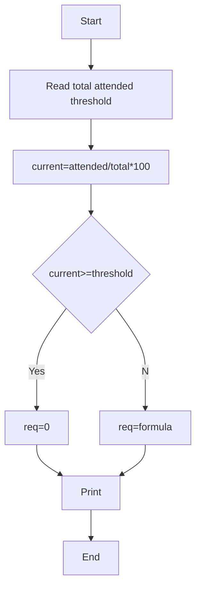

**Problem Solving Statement:** Calculate current attendance % and min consecutive classes needed to reach threshold.

**Algorithm:**
1. Read total, attended, threshold
2. current=attended/total*100
3. If current>=threshold req=0 else formula

**Flowchart:**

Sample Input 1:
100
65
75

Sample Output 1:
65.00
40

